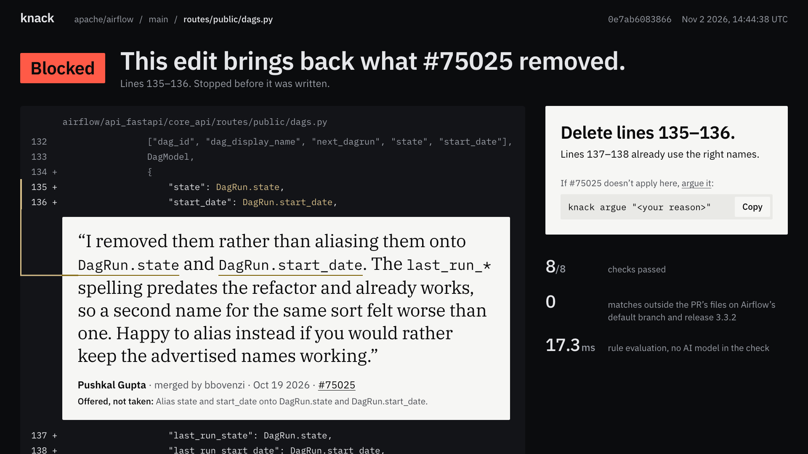
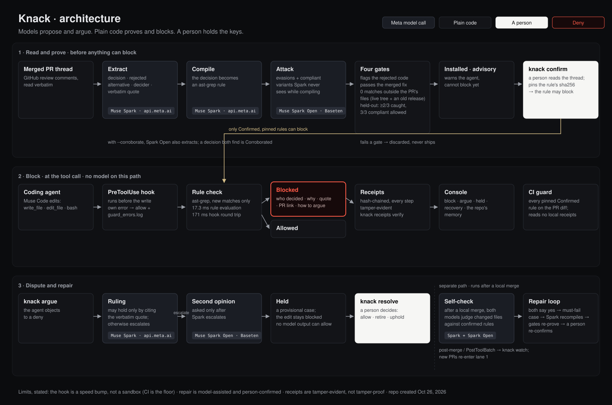

# Knack

Never argue the same PR twice.

Knack turns your team's code-review decisions into rules your coding agent can't break, and shows it who decided.



## The problem

Every team has argued the same point twice: the decision lives in a merged PR thread no agent has read.
The next agent ships the rejected alternative with confidence, and review starts over from zero.
That unread past is intent debt, and it compounds with every agent-written diff.

## Get it running

Prerequisites: git, [uv](https://docs.astral.sh/uv/), jq (one check below uses it) and Python 3.11. If Python 3.11 is not installed, `uv sync --frozen --extra dev --python 3.11` downloads it, which needs network once. ast-grep comes from the pinned `ast-grep-cli==0.51.0` dependency, so there is nothing else to install.

```sh
git clone https://github.com/vedntzz/Knack.git
cd Knack
uv sync --frozen --extra dev --python 3.11
source .venv/bin/activate
bash scripts/reproduce.sh
```

The last command checks every claim below and takes about 70–80 s once installed, ending `PROOF: PASS`. A cold first install takes longer, because `uv sync --frozen --extra dev --python 3.11` may download Python 3.11 first. `bash scripts/demo_block.sh` replays run 3's recorded edit to #75025's routes through the real user-level hook, in a sandbox HOME and clone, with no model and no network:

```sh
bash scripts/demo_block.sh
```

## See it in the console

One command serves the block above from the committed one-story receipts and the committed airflow registry. It reads no `~/.knack`, needs no API keys and binds to loopback only:

```sh
KNACK_CONSOLE_RECEIPTS=$PWD/mockups/fixtures/one_story/receipts.jsonl KNACK_REGISTRY=$PWD/data/registry/airflow.json knack console
```

Then open:

- The block page for receipt `0e7ab6083866`: http://127.0.0.1:7655/verdict/0e7ab608386631d65da47ec1bd194f45a335f49a0a8750635fc608f6559e65a9
- The held page, where both models escalated and a person upheld the decision: http://127.0.0.1:7655/verdict/0e7ab608386631d65da47ec1bd194f45a335f49a0a8750635fc608f6559e65a9/held

`bash scripts/e2e_console.sh` runs the whole story live against a running console and ends `E2E: PASS`.

## How it works



- **Spark proposes.** Muse Spark reads merged PRs and compiles each decision into an ast-grep rule.
- **Spark Open attacks.** Muse Spark Open, a second, separately run Meta model, writes held-out variants Spark never sees.
- **Plain code guards.** At edit time a hook runs ast-grep plus a diff check: no model, no network. If Knack itself fails, the agent proceeds and the failure is logged to `.knack/guard_errors.log`.
- **A person confirms.** Only AST-checkable rules on a Confirmed root can block; confirming pins the rule's sha256.

Full loop, labels and argue flow: [docs/details.md](docs/details.md).

## Where we tested it

Airflow and FastAPI are the committed runs: 17 of the 101 PRs yield 31 rejected alternatives, all verbatim.

| Repo | PRs read | Verbatim rejections | Rules proven | Held-out | Confirmed / blocking |
|---|---|---|---|---|---|
| apache/airflow | 51 | 17 | 5 installed | 3 pass both sides | 3 rules block (5 roots) |
| fastapi/fastapi | 50 | 14 | 7 installed | 4 pass both sides | 2 rules block (2 roots) |
| pydantic (blind) | 100 | 13 | 3 recorded (1 pass, 2 fail) | 1 of 3 recorded pass; log ends mid-run | 0 Confirmed, 0 block (run log, not checked by reproduce.sh) |
| pytorch | — | — | 0: models disagreed, no rule | — | 0 |

Pydantic detail: [spikes/pydantic_blind.md](spikes/pydantic_blind.md). PyTorch: Spark and Spark Open disagreed on every PR, so nothing met the corroboration bar and no rule shipped. No PyTorch output is committed, so `reproduce.sh` does not check that line.

## How it uses Meta's models

| Model | Host | Job | Why it isn't a wrapper |
|---|---|---|---|
| Muse Code | your machine | the coding agent the guard hooks | Knack is the hook around the agent, not a prompt: a plain-code deny with a citation. |
| Muse Spark (`muse-spark-1.3`) | api.meta.ai | extracts decisions, compiles rules, argues objections | It proposes; plain code proves. No model output can allow a block. |
| Muse Spark Open (`meta-models/muse-spark-open-1026`) | Baseten (`inference.baseten.co`) | corroborates, writes held-out variants, gives the second opinion | A second model checks the first; neither is in the verdict path. |

The block path and `reproduce.sh` call no model.

## Proof: reproduce.sh runs in 80 s

`bash scripts/reproduce.sh` checks every row in one run. The funnel: 101 PRs → 107 decisions → 22 roots → 12 installed rules → 5 that block. The last line is the verdict: `PROOF: PASS` (exit 0) means every step ran and every regenerated file matched its committed copy; `PROOF: FAIL (<step>)` (exit 1) names the first step that did not. FAIL cells in the grid are measured results, by design. `reproduce.sh` never rewrites `bench/PROOF-GRID.md`; it regenerates the grid, prints it and fails if it differs from the committed file by a byte. It reads only committed files: no network, no model, no home registry.

| Claim | Command |
|---|---|
| 101 PRs read, 107 decisions, 22 roots (7 Confirmed), 12 installed rules | `python -m knack.reproduce breadth` |
| 5 decisions block; every other installed rule only warns | `python -m knack.reproduce grid` |
| 31 rejected alternatives, all verbatim | `python -m knack.reproduce extraction` |
| 17 PRs hold a rejected alternative | `jq -s '[.[]\|select([.decisions[]?.rejected_alternatives[]?]\|length>0)]\|length' spikes/batch/*/decisions.jsonl` |
| 13 outcomes per side: 8 pass, 3 no rule, 2 fail held-out. 8 of 13 PRs pass each held-out evaluation (same-model and cross-model); 7 pass both. | `python -m knack.reproduce heldout` |
| 7 of 22 roots are Confirmed, none seeded | `grep -h '"status"\|"seeded"' data/roots/*/*.json \| sort \| uniq -c` |
| Bench report regenerates byte for byte | `bash scripts/reproduce.sh` |
| 5068 commits scanned, 0 repeat commits (0 human, 0 bot) | `python -m knack.reproduce repeats` |
| e2e steps pass 26/26 | `bash scripts/e2e.sh` |
| 17.3 ms rule evaluation on the block (this run) | `jq .block.guard_ms mockups/fixtures/one_story/latency.json` |
| 171 ms hook round trip on the block (this run) | `jq .wall_ms.block mockups/fixtures/one_story/latency.json` |
| 8 receipts, chain intact | `knack receipts verify --path mockups/fixtures/one_story/receipts.jsonl` |

Timings are this run (2026-11-02; recorded edit replay; real hook, real model calls in the argue steps): 171 ms hook round trip; 17.3 ms rule evaluation. Across today's three runs the spike quotes 16.3–18.4 ms for rule evaluation and 163–256 ms for the round trip; the two earlier runs' outputs are not in the repo, so no command regenerates those ranges ([spikes/one_story_live.md](spikes/one_story_live.md)).

RejectBench-Fresh, tickets past the agent's training cutoff, is pre-registered in [bench/PREREGISTRATION-FRESH.md](bench/PREREGISTRATION-FRESH.md) and not run: 1 of its 5 candidate tickets passed the screen.

## Using it on your repo

Each repo gets one home registry under `~/.knack` (or `KNACK_HOME`, as `$KNACK_HOME`); `knack init` writes it, the hooks read it. Live runs need `MODEL_API_KEY`, `BASETEN_API_KEY` and a read-only `GITHUB_TOKEN`. Watch fires after a local merge; the batch hook does not fire on a GitHub merge event. Detail: [docs/setup.md](docs/setup.md).

## What it doesn't do

- The person-only gate is not a sandbox: a determined agent running as you can set `KNACK_HUMAN=1` and hide `knack resolve` in a variable, a script or `python -c`. The CI guard is the backstop.
- Changing one byte of a Confirmed rule turns its block into a silent allow: the pin no longer matches and nothing is logged.
- Receipts are tamper-evident for edits and middle deletions, not for truncation.
- Two live rule gaps: #15937 still misses a `**` splat and a media-type constant; #16062's broad branch can trip on unrelated constants.
- Small bench: 2 repos, 9 tickets, 24 runs per arm; the intervals overlap, so no difference between arms is claimed.
- Token confidence is not exposed by the hosted endpoint; corroboration is the brake. [spike/kn-73-open-weights](spikes/open_weights.md)

## Hackathon

Problem statement: Build for Your World, because the world an agent works in is a team's own codebase, and that world's rules are the decisions the team already argued out in review, which the agent has never read.

Repo created Oct 26, 2026; all work done during the event. Solo. All code in this repository was written during the event, from Oct 26, 2026. The exception is prior research, done before the event and rebuilt from scratch here: the PRD, the demo-chain analysis of apache/airflow PR #75025, a prototype ast-grep rule, the Oct 25 unscripted agent test, and the Muse Code hook-contract test.

Knack is MIT; see [LICENSE](LICENSE). Airflow fixtures are excerpts from [apache/airflow](https://github.com/apache/airflow) PRs (Apache License 2.0). FastAPI fixtures are excerpts from [fastapi/fastapi](https://github.com/fastapi/fastapi) PRs (MIT).
